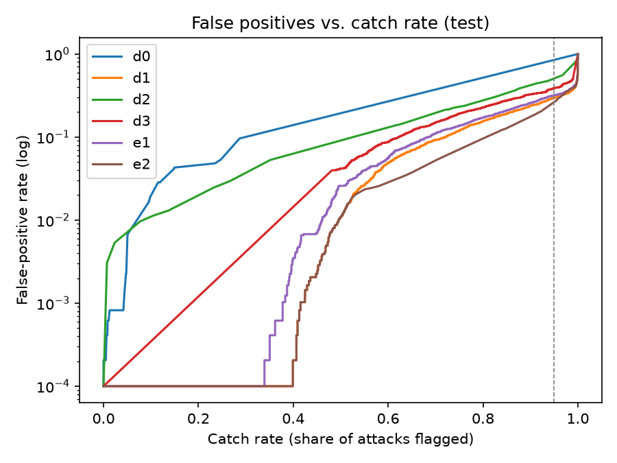

# GuardLens

**A defensive guardrail for LLM applications, and an honest benchmark of how well
different guardrail strategies catch prompt-injection and jailbreak attempts.**

<!-- DEMO GIF: record with docs/demo_script.md and save as docs/demo.gif, then replace this line:
 -->

Any app that puts user text in front of an LLM can be steered by *prompt injection*
("ignore your instructions and …") or *jailbreaks* (framings meant to get around a model's
safety rules). GuardLens builds detectors that flag such inputs, serves them behind an API,
and measures them fairly: catch rate vs. false-positive rate, latency and cost, with
confidence intervals, and on an **attack family no detector saw during training**.

> **Scope.** GuardLens is purely defensive. It never generates, mutates or optimizes attacks.
> Public datasets are used only as labelled material to train and test detectors, and
> attacks are described by category in this repository, never reproduced.

## Headline result

Trained detectors are near-perfect on attack families they were trained on, and close to
chance on a new one. An LLM judge generalizes much better, and a cascade that only asks the
judge when the fast model is unsure gets most of both.

AUROC on the test split (95 % bootstrap CI; 0.5 = chance, 1.0 = perfect), run once from the
tagged commit `eval-v1`:

| Detector | Seen families (5,212 texts) | **Held-out family** (3,000) | All test (8,212) | Latency p50 / p95 | Cost / 1k texts |
|---|---|---|---|---|---|
| D0 regex rules | 0.661 | 0.521 | 0.599 | 0.1 / 0.8 ms | $0 |
| D1 fine-tuned encoder | **0.995** [0.994, 0.997] | 0.598 [0.578, 0.619] | 0.928 | 23 / 35 ms | $0 |
| D2 LLM judge | 0.877 | **0.802** [0.786, 0.816] | 0.842 | 1.2 / 2.2 s | $0.17 |
| D3 embedding k-NN | 0.987 | 0.513 [0.494, 0.532] | 0.883 | 12 / 19 ms | $0 |
| E1 mean(D1, D3) | 0.995 | 0.564 | 0.919 | 36 / 51 ms | $0 |
| **E2 cascade D1 → D2** | 0.992 | 0.782 [0.764, 0.798] | **0.945** | 31 ms / 2.1 s | $0.07 |



At each detector's operating point (threshold fixed on dev to catch 95 % of dev attacks),
D1 catches 95 % of seen-family attacks at a 1.8 % false-positive rate, but only 52 % of the
held-out attacks at a 38 % false-positive rate on their look-alikes (F1 0.961 → 0.550).
All pairwise differences above are significant (paired bootstrap, p < 0.001). Full tables:
[`results/summary.csv`](results/summary.csv), per slice and per category in
[`results/`](results/); held-out curves in
[`results/figures/fpr_vs_catch_test_heldout.png`](results/figures/fpr_vs_catch_test_heldout.png).

### What the errors look like

From a manual review of 100 of D1's test errors ([details](results/error_analysis/d1_test_error_analysis.md)):

- **Missed held-out attacks** wrap a harmful request in a legitimizing frame: an expert or
  researcher role, a fiction task, a "good cause", a social scenario. Most score just under
  the threshold: D1 finds them suspicious, not suspicious enough.
- **False positives on the held-out slice** are *harmless* requests written in the same
  frames. On unfamiliar data, D1 reacts to style, not intent.
- **Many seen-family "errors" are label problems**: role-play and persona text labelled
  differently by different source collections, ordinary tasks labelled as attacks, and very
  short messages from a password game that only make sense in context.

## How it works

```
public datasets ─► unify, deduplicate (exact + near-duplicate), split by source & family
                   (one attack family held out entirely for test)
                      │
        ┌─────────────┼──────────────┬──────────────────┐
        D0 rules      D1 encoder     D2 LLM judge       D3 k-NN
        (regex)       (mmBERT,       (Claude Haiku 5.5, (multilingual-e5,
                       fine-tuned,    rubric prompt,     10 nearest
                       calibrated)    JSON answers)      training texts)
                      │
        same interface: score(text) -> {score, category, reason}
                      │
        one runner ─► same examples, thresholds set on dev only ─► report:
        ROC / PR / FPR-vs-catch curves, bootstrap CIs, paired tests,
        per category and seen vs. held-out, latency, cost
                      │
        service: FastAPI /check  (E2 cascade, falls back to D1)
        demo:    Gradio page, every detector side by side
```

| | What it is |
|---|---|
| **Data** | 12 public datasets ([licenses below](#datasets-and-licenses)): prompt injections, jailbreak prompts, benign requests, *hard negatives* (security questions, fiction, role-play, over-refusal tests) and Arabic / French / Spanish / German text. 37,754 texts after deduplication: train 24,328 · dev 5,214 · test 8,212. WildJailbreak's adversarial jailbreaks (and their benign look-alikes) are held out of train and dev entirely. |
| **D0** | Hand-written regex rules (instruction override, prompt extraction, persona jailbreaks, fake delimiters, obfuscation), combined by noisy-OR. A transparent baseline. |
| **D1** | `jhu-clsp/mmBERT-base` (multilingual ModernBERT) fine-tuned as a 4-class classifier (benign + 3 seen attack families); word-embedding table frozen to fit an 8 GB GPU; 512 tokens, keeping the start and end of long texts; temperature-scaled on dev. |
| **D2** | Claude Haiku 5.5 at low effort scores each text against a written rubric and returns structured JSON (probability, category, one-line reason). The text is passed as untrusted data. Answers are cached; every call's tokens and cost are logged against a spending cap. |
| **D3** | `intfloat/multilingual-e5-base` embeddings; similarity-weighted vote of the 10 nearest training texts (exact search with numpy). |
| **E1 / E2** | Fixed-rule ensembles, nothing fitted: E1 averages D1 and D3; E2 lets D1 decide when its calibrated score is below 0.05 or above 0.95, and asks D2 otherwise. |

**Evaluation rules.** Thresholds, prompts and hyperparameters are chosen on dev only. The test
split is scored once, from a git commit tagged `eval-v*` with a clean working tree (the runner
refuses otherwise). Every run records its config, data hash and commit.

> **Note on `eval-v1`.** The tagged commit is missing the 7 files of `src/guardlens/data/`
> (an unanchored `data/` pattern in `.gitignore` ignored them; found by the fresh-clone check
> in M6 and fixed in commit `3d65fed`). The test results stand: those files are byte-identical
> to the copy archived when the data was built, were last modified five days before the tag,
> and are unchanged since. To reproduce the test run, use the `eval-v1` code plus
> `src/guardlens/data/` from `3d65fed`. A test now fails if any source file is git-ignored.

## Run the guardrail

```powershell
uv run gl serve        # http://127.0.0.1:8000, interactive docs at /docs
```

```powershell
Invoke-RestMethod -Method Post http://127.0.0.1:8000/check -ContentType "application/json" `
  -Body '{"text": "What is a good recipe for a quick vegetable soup?"}'
```

```json
{"allow": true, "score": 0.006, "threshold": 0.365, "category": "none",
 "reason": "encoder: p(attack) = 0.01", "decided_by": "d1", "mode": "e2",
 "fallback": null, "latency_ms": 403.5}
```

(The first request after start-up includes warm-up; later D1-only requests take ~30–80 ms.)

- `allow: false` means block. `decided_by` tells whether D1 or the judge made the call.
- Without an `ANTHROPIC_API_KEY`, or once the spending cap is reached, the service runs on D1
  alone and says why in `fallback`. Set `mode: d1` in [`configs/service.yaml`](configs/service.yaml)
  for a free, offline service.
- Only `"direction": "input"` is supported (HTTP 422 otherwise); texts over 100,000
  characters get HTTP 413. `GET /health` reports whether the judge is available.

**Demo page** (every detector's verdict side by side, local only):

```powershell
uv run --group demo python app/gradio_app.py   # http://127.0.0.1:7860
```

## Reproduce

**Needs:** Python 3.12, [uv](https://docs.astral.sh/uv/), an NVIDIA GPU with ≥ 8 GB (PyTorch
CUDA 13.2 wheels are pinned in `pyproject.toml`), disk space for ~7 GB of datasets and
models plus the Python environment (several GB for PyTorch), a Hugging Face token
with the terms of the two gated datasets (WildJailbreak, XSTest) accepted, and optionally an
Anthropic API key for D2. Developed on native Windows 11.

```powershell
git clone <this repo> ; cd GuardLens
uv sync
copy .env.example .env          # then fill in HF_TOKEN (and ANTHROPIC_API_KEY for D2)
uv run gl check-env             # Python / CUDA / GPU check

uv run gl build-data            # download, deduplicate, split  -> data/processed/v2/
uv run gl train --detector d1   # ~25 min on an RTX 5070 laptop GPU
uv run gl eval --detector d0 --split dev
uv run gl eval --detector d1 --split dev
uv run gl eval --detector d3 --split dev
uv run gl eval --detector d2 --split dev   # ~25 min, ~$0.90 of API calls
uv run gl ensemble --split dev
uv run gl report --split dev    # results/*_dev.csv and results/figures/*_dev.png
uv run pytest -q                # offline tests: no GPU, network or API key needed
```

What to expect: the dataset build is deterministic: `train.json`, `dev.json` and `test.json`
are byte-identical (`manifest.json` differs only in its timestamp, commit and a hash of the
config file, which git's Windows line-ending conversion changes). D0 and D3 reproduce exactly. D1 lands within the confidence intervals but not bit-for-bit (GPU training
is not fully deterministic). D2 answers can vary slightly between API calls; cached answers
are reused. The test split only runs from a commit tagged `eval-v*`.

Data, model weights, caches and raw predictions live in `data/` and are never committed.

## Limitations

- **Not a content-safety filter.** GuardLens flags *manipulation* of the model (instruction
  overrides, prompt extraction, jailbreak framings). A plainly harmful request asked directly,
  with no manipulation, is allowed by design, and the benign data even includes sensitive-
  sounding questions so that topic alone doesn't trigger a block. Pair it with a
  topic-moderation model and rely on the LLM's own safety training for that layer.
- **One held-out family.** Generalization is measured on WildJailbreak's adversarial
  jailbreaks only; other unseen attack types may behave differently.
- **Label noise.** Some sources label similar role-play / persona text differently, and
  password-game messages are attacks only in context. This caps every seen-family number.
- **A hard contrast set.** The held-out benign texts are written in an adversarial style on
  purpose, so held-out false-positive rates are pessimistic for ordinary traffic.
- **Operating points come from dev.** Dev also chose D1's epoch and temperature and D2's
  prompt, so dev numbers are slightly optimistic; test numbers are the honest ones.
- **The 95 %-catch operating point is aggressive.** For E2 it means blocking whenever the
  judge gives a probability of about 35 % or more, so a text the judge describes as benign
  can still be blocked. Lower it or raise it in `configs/service.yaml` for your own
  trade-off, measured on dev.
- **Latency tail.** E2 is fast when D1 is sure, ~1–3 s when it asks the judge (43 % of test
  texts, 13 % of dev texts). Latency was measured on one laptop.
- **Input direction only.** No output moderation yet.

## Datasets and licenses

| Source | Hugging Face id | License | Role |
|---|---|---|---|
| deepset | `deepset/prompt-injections` | Apache-2.0 | prompt injection + benign |
| Gandalf | `Lakera/gandalf_ignore_instructions` | MIT | prompt injection |
| Mosscap | `Lakera/mosscap_prompt_injection` | MIT | prompt injection (password game) |
| SPML | `reshabhs/SPML_Chatbot_Prompt_Injection` | MIT | chatbot prompt injection + benign |
| In-the-wild jailbreaks | `TrustAIRLab/in-the-wild-jailbreak-prompts` | MIT | jailbreak templates + regular prompts |
| jackhhao | `jackhhao/jailbreak-classification` | Apache-2.0 | jailbreak templates + benign |
| WildJailbreak (gated) | `allenai/wildjailbreak` | ODC-BY | **held out**: adversarial jailbreaks + benign look-alikes |
| XSTest (gated) | `walledai/XSTest` | CC-BY-4.0 | benign hard negatives |
| OR-Bench | `bench-llm/or-bench` | CC-BY-4.0 | benign hard negatives (over-refusal) |
| Dolly | `databricks/databricks-dolly-15k` | CC-BY-SA-3.0 | benign |
| Aya | `CohereLabs/aya_dataset` | Apache-2.0 | benign, multilingual |

Datasets are downloaded by `gl build-data` from their official sources and never
redistributed here. Plain harmful requests *without* manipulation are excluded from the
attack class: this benchmark is about manipulation, not topic.

## Repository layout

```
configs/      data.yaml, detectors.yaml, eval.yaml, service.yaml
src/guardlens/
  data/       loaders, deduplication, source/family-aware splits
  detectors/  d0_heuristic, d1_encoder, d2_judge (+ d2_prompt), d3_knn, registry
  training/   encoder fine-tuning and calibration
  eval/       runner, metrics, bootstrap statistics, slices, ensembles, report, error sampling
  service/    FastAPI app, guard logic, demo page
app/          gradio_app.py
results/      summary CSVs, figures, error analysis (no raw predictions)
tests/        offline tests on harmless placeholder strings
```

## License

Code: MIT (see `LICENSE`). Datasets and model weights are not included; each dataset is
downloaded from its original source and stays under its own license (see above).

